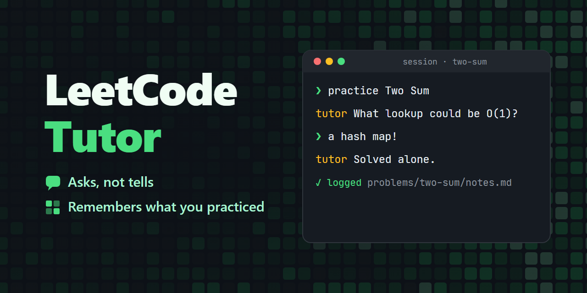

# LeetCode Tutor

[](https://github.com/mileschintw/leetcode-tutor/releases/latest)
[](https://github.com/mileschintw/leetcode-tutor/actions/workflows/ci.yml)
[](./LICENSE)



**An AI LeetCode tutor for coding-interview prep that asks, not tells.** It guides you through LeetCode, NeetCode and your own problems with Socratic hints instead of handing you the solution, and it keeps a practice log you own: every attempt, mistake and key takeaway goes into your own git repository, ready for review sheets before an interview and an optional Notion sync. It installs as a Claude Code plugin and as agent skills for Codex, Cursor and Antigravity, and it also works on claude.ai, the Gemini app and ChatGPT.

Asking a chatbot for the answer solves one problem once. LeetHub-style tools save the code you got accepted. LeetCode Tutor records how you got there (the approach, where you got stuck, what to remember), so the next interview starts from your own notes instead of from zero.

v3.0 is the current version (see the [CHANGELOG](./CHANGELOG.md)). It succeeds the copy-paste prompt in [leetcode-tutor-prompt](https://github.com/mileschintw/leetcode-tutor-prompt) (v2), which is archived.

## Platforms

| Tier | Platforms | What you get |
|------|-----------|--------------|
| Officially tested | Claude Code | All three skills, and a Practice Log saved in your workspace |
| Should work | Codex, Cursor, Antigravity | All three skills, the same as Claude Code |
| Should work | claude.ai, the Gemini app | The tutor skill, uploaded as a zip; no Practice Log of its own (see [Chat apps](#chat-apps)) |
| Prompt only | ChatGPT, Perplexity, anything else | The tutor as a copy-paste prompt; no Practice Log of its own |

"Should work" means the files are built to each platform's documented format but haven't been tested by hand yet.

## Install

### Claude Code plugin

**For a Practice Workspace (recommended):** install the plugin into the workspace's folder only, so the skills load there and add nothing to your other projects. In a shell, create the folder and install with project scope (Claude Code 2.1.292 or later; on older versions, run `claude plugin marketplace add mileschintw/leetcode-tutor` first and install `leetcode-tutor@leetcode-tutor`):

```
mkdir practice-log && cd practice-log && git init
claude plugin install leetcode-tutor --marketplace mileschintw/leetcode-tutor --scope project
```

Then start `claude` in that folder and say "set up my practice workspace". Project scope enables the plugin in `.claude/settings.json`, which you commit with the workspace; on another machine, run the same install command once in the clone. Use `--scope local` instead to keep it uncommitted. Either way the tutor is unavailable outside the workspace. Inside a session, `/plugin install leetcode-tutor --marketplace mileschintw/leetcode-tutor` does the same when you pick the project or local scope.

**For the tutor anywhere:** in Claude Code (2.1.275 or later), run:

```
/plugin install leetcode-tutor --marketplace mileschintw/leetcode-tutor
```

and pick the user scope. On older versions, add the marketplace first:

```
/plugin marketplace add mileschintw/leetcode-tutor
/plugin install leetcode-tutor@leetcode-tutor
```

You also need Python 3 (the skills use a small `practice-log` tool built on its standard library) and git.

### Codex, Cursor and Antigravity

**For a Practice Workspace (recommended):** put the skills in the workspace's folder only, so they load there and add nothing to your other projects. Codex, Cursor and Antigravity all read project skills from `.agents/skills/`, so the same zip serves all three. Download `leetcode-tutor-agents-skills.zip` from the [latest release](https://github.com/mileschintw/leetcode-tutor/releases/latest) (it holds all three skills, side by side as they need to be) and unzip it into the folder:

```
mkdir practice-log && cd practice-log && git init
unzip ~/Downloads/leetcode-tutor-agents-skills.zip
```

On Windows, `tar -xf` does the same. Then start your tool in that folder and say "set up my practice workspace"; restart it if the skills don't appear. Commit `.agents/skills/` with the workspace and the tutor works on any machine you clone it to. Updating means unzipping the new release over it.

**For the tutor anywhere:** install the plugin for your user:

- **Codex:** `codex plugin marketplace add mileschintw/leetcode-tutor`, then install `leetcode-tutor` from the Plugins Directory.
- **Antigravity:** `agy plugin install https://github.com/mileschintw/leetcode-tutor`.
- **Cursor:** in Customize, install the plugin and pick the user scope. Team admins can add it from Dashboard → Plugins & MCPs → Import from Repo. Or unzip the zip above in your home directory, which puts the skills in `~/.agents/skills/`.

Codex and Antigravity have no project-scope plugin install: their documentation describes no scope option for `codex plugin` or `agy plugin install`, so a plugin install is global. Use the zip to keep the tutor to one workspace. Cursor's plugin installer does offer a project scope, so there you can install the plugin that way instead of using the zip. If you installed the plugin globally and want it off elsewhere, Codex's `/plugins` browser lets you switch it off.

These need Python 3 and git too.

### claude.ai and the Gemini app

Download a zip from the [latest release](https://github.com/mileschintw/leetcode-tutor/releases/latest) and upload it as a skill: `leetcode-tutor-claude-ai.zip` for claude.ai, `leetcode-tutor-gemini-perplexity.zip` for the Gemini app (and for Perplexity, where your plan accepts skill uploads).

### ChatGPT, Perplexity and anything else

Attach [prompts/leetcode-tutor.md](./prompts/leetcode-tutor.md) to a Project as a file, or paste it as your first message. It is too long for most Project instruction fields.

### Updating

- **Claude Code:** `claude plugin marketplace update leetcode-tutor`, then `claude plugin update leetcode-tutor@leetcode-tutor`, and restart Claude Code.
- **Uploads and the prompt:** download the new zip from the latest release, or paste the prompt again.

## Practising

Name a Problem, for example "Let's do LeetCode 1. Two Sum". The tutor starts with a structured overview (the First Response), then guides you with questions instead of answers, from understanding the Problem through strategy and implementation to testing. It doesn't write your solution unless you ask. You write and run your code on LeetCode or NeetCode. For a paywalled or self-authored Problem, the tutor writes and runs local tests, using the Problem's own test harness if it has one. Write in any language: the tutor replies in the language you use.

- **Recap Mode:** say you already know a Problem and you get a short overview, then a prompt to recall your Key Takeaway, instead of a full Session.
- **Need Review:** when you saw the solution, asked for a skeleton or jumped to the conclusion, the tutor marks the Problem Need Review and tells you why. It clears the mark when you say you've got it or when you later solve the Problem on your own in a full Session. You can set or clear it yourself at any time. A Recap never clears it.
- **Review Sheets:** before an interview, name a goal ("Grind 75 graphs", "my Need Review problems", a company) and the tutor builds a Review Sheet. For each matching Problem it gives the Key Takeaway, approach and past mistakes, it flags which ones are worth redoing, and it suggests Problems you haven't done yet. You can start a Recap straight from any Problem on it.
- **What next:** ask what to practise and the tutor suggests Problems from your Practice Log and its gaps.

## Your Practice Log

The tutor keeps your practice in a Practice Workspace, a git repository you own. If you start a Session outside one, it offers to create one for you. At the end of each Session it saves the Attempt there (outcome, approach, the mistakes it saw, your code) with the Key Takeaway, and shows you what it wrote so you can correct it.

```
practice-log.json              workspace settings
README.md                      the generated index: every Problem by Problem List and topic
problems/<source>/<slug>/
  notes.md                     the Problem, its Key Takeaway and the Attempt log
  <date>-<approach>.<ext>      the code from each Attempt
review-sheets/                 saved Review Sheets
```

Push the workspace to GitHub and the index README shows your records on any device.

### Using Obsidian

The Practice Workspace is also an [Obsidian](https://obsidian.md) vault, with nothing to install.

- **Open it:** in Obsidian, choose "Open folder as vault" and pick the workspace folder. The index README and each Review Sheet link to every Problem's `notes.md`.
- **See your code files:** Obsidian lists only the file types it knows, so `.py`, `.cpp` and the like are hidden at first. Turn on Settings → Files and links → "Detect all file extensions" to see them.
- **Filter and sort:** each `notes.md` has flat frontmatter, so `difficulty`, `tags`, `lists` and `need_review` show as Properties. With the core Bases plugin (or the Dataview community plugin) you can build your own views, such as every Problem with `need_review` set, or a list's Problems by difficulty. These are suggestions to adapt, not views the tutor creates or has tested.
- **Edit freely:** your notes in the workspace are the Practice Log, so editing `notes.md` in Obsidian is fine. Keep the frontmatter flat (one `key: value` per line, lists as `[a, b]` or `- item` lines), then ask the tutor to check and re-index the workspace. Until then the index README is out of date, and the Notion Mirror shows your edit only after the next push.
- **Obsidian's settings in git:** the `.obsidian/` folder holds your vault settings and can be committed to share them between devices. The `.gitignore` that the tutor writes skips its per-device layout files (`.obsidian/workspace*.json`).

### Importing your old records

To bring in your Legacy Records, the practice history you kept before, ask to import them and name the source: a Notion export or connector, a LeetHub repository, or anything else. The `practice-log-import` skill merges them into your Practice Log by Problem ID, keeping every Attempt and where it came from. It asks once about any field it can't map, shows a preview and writes nothing until you confirm. Running it again adds nothing new.

### The Notion Mirror

To browse your Practice Log in Notion, ask to push it there. The `practice-log-mirror` skill publishes a one-way Mirror through your Notion connector, or, without one, through Notion's API with an integration token you create and set yourself (`NOTION_TOKEN`). Later pushes can rewrite only the pages that changed since the last push, which `mirror-state.json` in your workspace records. On first use it creates its own database, and every push regenerates one page per Problem, each linking to the Problem's folder on GitHub. It never touches your old Notion database. Your Practice Workspace has to be on GitHub first. Edits made in Notion are overwritten when the page is next pushed, so change your notes in the workspace. Once the Mirror is set up, the tutor asks after each Session and Review Sheet whether to push.

You can rename or move the Mirror database: pushes find it by its id, not its name. Don't rename or delete its properties: a push stops when `Problem ID` or `Pending` is missing, since without them it can't match pages or keep your pending Attempts safe.

The import and mirror skills only work with the tutor skill installed alongside them, which the plugin installs above do. They have no upload zips or prompts of their own.

## Chat apps

On claude.ai, the Gemini app, ChatGPT and other chat apps, the tutor teaches the same way, but it has no folder to save to. At the end of a Session it does one of two things:

- **With a Notion connector and a Mirror:** it writes the Attempt to the Mirror as a pending page.
- **Otherwise:** it prints an Attempt block for you to keep.

The next Import in your Practice Workspace brings pending pages home. Paste an Attempt block into an Import to bring it in too.

To find the Mirror, the tutor searches your Notion for "Practice Log" and checks which GitHub repository each match belongs to. It asks when there are several, and it can miss one you renamed unless you name your repository. So put your Mirror's link and your repository's URL in the chat app's Project instructions (a Project in claude.ai or ChatGPT, a Gem in the Gemini app), for example "My Notion Mirror is <link>, for github.com/<owner>/<repo>". The tutor then never has to search. Import warns you about pending pages it finds in any other database.

## Your data

The skills run no server and collect nothing. Your Practice Log is files in your own repository, and the `practice-log` tool reads and writes files on your machine. Notion is reached only when you ask for an Import or a Mirror push, or when the tutor saves a pending Attempt in a chat app, and only through your own Notion connector or your own integration token. The token is read from the `NOTION_TOKEN` environment variable you set; the tool sends it only to Notion's API and never prints or stores it. Import moves the pending pages it brought in to Notion's trash, and a push asks before trashing pages for Problems no longer in your log.

## Known limitations

- A very large first import gives an unwieldy preview ([#32](https://github.com/mileschintw/leetcode-tutor/issues/32)).
- Import has no guidance yet for records reachable only in a signed-in browser ([#29](https://github.com/mileschintw/leetcode-tutor/issues/29)).
- A first or full Mirror push through the connector sends every page through it, which costs tokens on a large log; later pushes can send only the pages that changed ([#33](https://github.com/mileschintw/leetcode-tutor/issues/33)).

## Project docs

- [CHANGELOG.md](./CHANGELOG.md): what changed in each version
- [CONTEXT.md](./CONTEXT.md): the project's domain language
- [docs/adr/](./docs/adr/): architecture decisions
- [docs/research/](./docs/research/): platform research behind those decisions
- [AGENTS.md](./AGENTS.md): how to work on this repository

## License

[MIT](./LICENSE)
